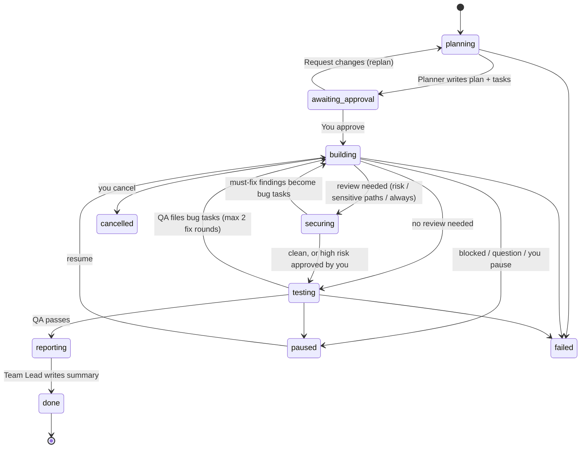
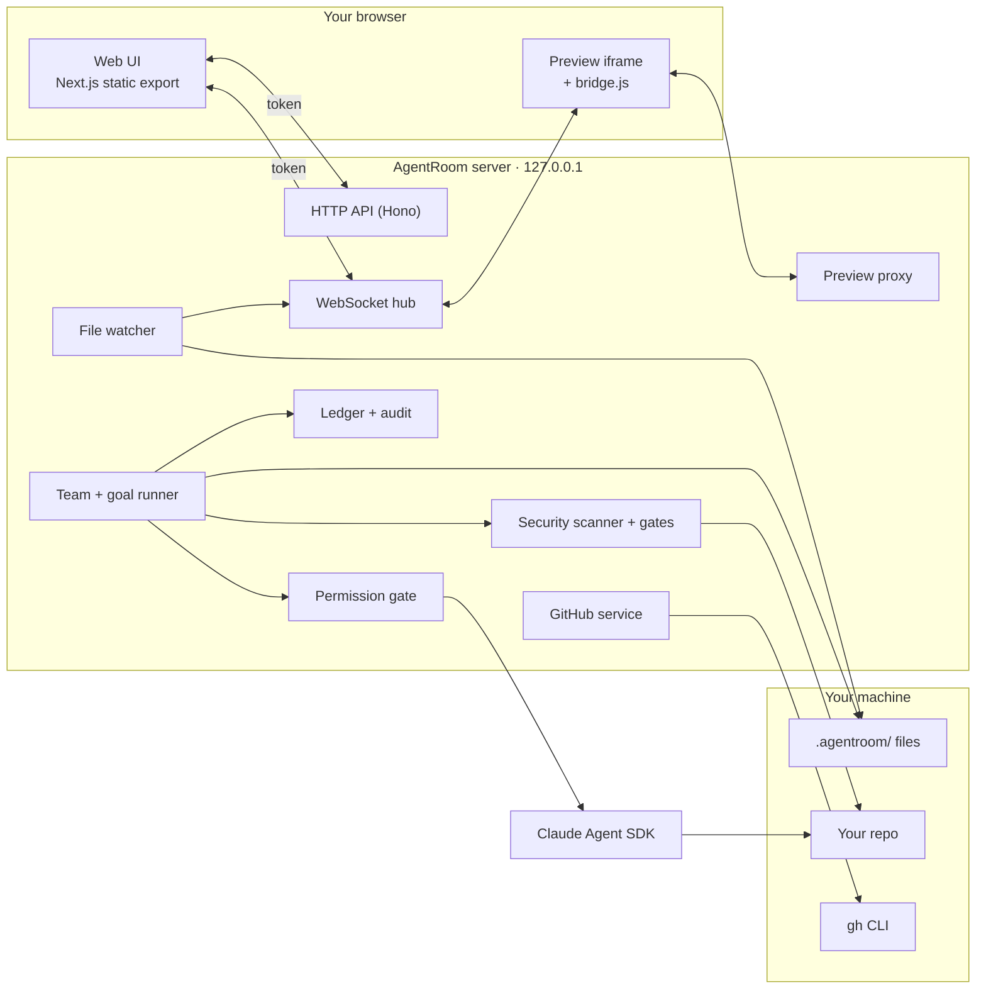

<div align="center">


# AgentRoom

**A local control room for your AI coding agents.**

Run a team of bots (Team Lead, Planner, Developer, Security Auditor, QA, Reviewer) in any repository.<br>
Watch every tool call live, approve risky actions, hand GitHub cards and Sentry errors to the team,<br>
and schedule work for later: wake up to a reviewed branch and a PR, not surprise edits.

[](https://www.npmjs.com/package/@kinleyrabgay/agentroom)
[](LICENSE)
[](https://nodejs.org)
[](tsconfig.json)
[](https://docs.claude.com/en/api/agent-sdk/overview)
[](CONTRIBUTING.md)
[](CONTRIBUTING.md#developer-certificate-of-origin)

[Quick start](#-quick-start) ·
[Features](#-features) ·
[CLI](#-cli-reference) ·
[Configuration](#%EF%B8%8F-configuration) ·
[Security](#-security-model) ·
[Architecture](#%EF%B8%8F-architecture) ·
[FAQ](#-faq) ·
[Contributing](CONTRIBUTING.md) ·
[Changelog](CHANGELOG.md)

</div>

---

## 📑 Table of contents

<details>
<summary>Expand</summary>

- [Why AgentRoom?](#-why-agentroom)
- [Quick start](#-quick-start)
  - [Requirements](#requirements)
  - [Install from source](#install-from-source)
  - [First run](#first-run)
- [Features](#-features)
  - [Team of bots](#team-of-bots)
  - [Goals: plan → review → build → security → test → report](#goals-plan--review--build--security--test--report)
  - [Task board](#task-board)
  - [Security review and scanning](#security-review-and-scanning)
  - [Prompt-injection guard](#prompt-injection-guard)
  - [Attachments](#attachments)
  - [Skills](#skills)
  - [In-app browser](#in-app-browser)
  - [GitHub board](#github-board)
  - [Approvals and permission modes](#approvals-and-permission-modes)
  - [Inbox and desktop alerts](#inbox-and-desktop-alerts)
  - [Usage, ledger and audit log](#usage-ledger-and-audit-log)
- [CLI reference](#-cli-reference)
- [Project layout](#-project-layout)
- [Configuration](#%EF%B8%8F-configuration)
  - [config.json](#agentroomconfigjson)
  - [settings.json](#agentroomsettingsjson)
  - [Bot files](#bot-files-botsidbotmd)
  - [Skill files](#skill-files-skillsnameskillmd)
  - [Environment variables](#environment-variables)
- [Tools reference](#-tools-reference)
- [Security model](#-security-model)
- [Architecture](#%EF%B8%8F-architecture)
  - [HTTP API](#http-api)
  - [WebSocket protocol](#websocket-protocol)
- [Development](#-development)
- [Troubleshooting](#-troubleshooting)
- [FAQ](#-faq)
- [Roadmap](#%EF%B8%8F-roadmap)
- [Contributing](#-contributing)
- [License](#-license)

</details>

---

## 💡 Why AgentRoom?

A single coding agent in a terminal is hard to supervise. You can't see what it's doing, and once you give it more autonomy you can't easily step in. AgentRoom gives agents a structure and gives you a window into them.

| | |
|---|---|
| 👥 **A team, not a lone agent** | Bots have roles and a reporting line. The Team Lead plans and delegates; the others build, test and review. |
| 👀 **Everything is visible** | Every message, tool call, file edit and shell command streams into a local web UI as it happens. |
| ✋ **You stay in control** | Edits and shell commands wait for approval. Dangerous commands (`git push`, `rm -rf`, `gh pr merge`, …) always ask. |
| 📁 **Plain files, shared with your team** | Bots, skills and the task board live in `.agentroom/`. Commit it and everyone runs the same team. |
| 🔒 **Local first** | The server binds to `127.0.0.1` and needs a per-run token. Bots reuse your own git, `gh` and Claude login; tokens you add (Sentry, MCP, webhooks) stay in a local, gitignored file. |

---

## 🚀 Quick start

### Requirements

| Requirement | Why | Check |
|---|---|---|
| **Node.js 20+** | Runs the CLI and server | `node -v` |
| **git** | Bots commit on goal branches | `git --version` |
| **Claude Code login** *or* `ANTHROPIC_API_KEY` | Auth for the Claude Agent SDK | `claude --version` |
| **GitHub CLI** *(optional)* | GitHub board, PRs | `gh auth status` |

### Install

```bash
npm install -g @kinleyrabgay/agentroom
```

The command is `agentroom`. Or run it once without installing: `npx @kinleyrabgay/agentroom start`.

### Install from source

```bash
git clone https://github.com/kinleyrabgay/agentroom.git
cd agentroom
npm install && npm --prefix web install
npm run build        # builds the UI (dist/ui) and the CLI (dist/cli.js)
npm link             # puts `agentroom` on your PATH
```

### First run

```bash
cd your-project
agentroom doctor     # ✔/✘ for node, git, git user, git repo, gh auth, claude CLI, API key, .agentroom/
agentroom start      # scaffolds .agentroom/ if missing, starts the server, opens the UI
```

The URL printed on start contains the session token (`?t=…`). If the browser doesn't open, copy that URL.

<details>
<summary><b>What you'll see</b></summary>

1. **Team** view with six bots, each with an avatar, color and live status (`idle`, `thinking`, `working`, `waiting`, `error`).
2. Click a bot to open its panel: **Chat**, **Activity** (every tool call and result), **Skills**, **Browser** and **Config**.
3. Type a goal into the Team Lead's chat, or open **Tasks** and create a goal. The Planner writes a plan and waits for your approval.
4. Approve the plan. The Developer builds, the Security Auditor reviews the diff when needed, QA tests, and the Team Lead reports back. Approval prompts show up in the top bar and the bot's chat.

</details>

---

## ✨ Features

### Team of bots

`agentroom init` scaffolds six bots from [`templates/bots/`](templates/bots):

| Bot | Avatar | Default tools | Default skills | Reports to |
|---|---|---|---|---|
| **Team Lead** | 🧭 | Read, Grep, Glob | planning, code-review | — |
| **Planner** | 🗺️ | Read, Grep, Glob, WebSearch, WebFetch | repo-explore, planning | Team Lead |
| **Developer** | 🛠️ | Read, Grep, Glob, Edit, Write, Bash, Browser | git-workflow, testing | Team Lead |
| **Security Auditor** | 🛡️ | Read, Grep, Glob, Bash | security-review | Team Lead |
| **QA** | 🧪 | Read, Grep, Glob, Edit, Write, Bash, Browser | testing | Team Lead |
| **Reviewer** | 🔍 | Read, Grep, Glob, Bash | code-review, git-workflow | Team Lead |

> Exact tools and skills are defined in each `bot.md`; edit them freely.

- A bot that has reports gets a `delegate` tool to hand work to them.
- Every bot gets the task tools (`task_list`, `task_get`, `task_create`, `task_update`, …) and can reach you through `ask_human` and `notify_human`.
- Each bot keeps its own session, so conversations continue across messages. **Reset** clears it.
- Add bots with `agentroom bot add` or from the UI. Each bot is one Markdown file.

<details>
<summary><b>Context each bot receives</b></summary>

- Its persona (the body of `bot.md`)
- Its role, its manager and its reports
- The first 8,000 characters of your project's `CLAUDE.md`, if present
- Its assigned skills, loaded through the Claude plugin system
- Descriptions of AgentRoom's host tools

</details>

### Goals: plan → review → build → security → test → report

A **goal** is a piece of work you hand to the team. The goal runner drives it through a fixed lifecycle: **plan → review → build → security → test → report**.



| Status | What's happening |
|---|---|
| `planning` | The Planner explores the repo and writes a plan plus ordered tasks with acceptance criteria. |
| `awaiting_approval` | Nothing runs until you **approve**, or **replan** with feedback. |
| `building` | The Developer works through `dev` and `bug` tasks in order, committing on the goal's branch (`agentroom/<goal-id>`). Bots never push. |
| `securing` | The Security Auditor reviews the diff and the automated findings, records real issues with `security_finding`, and turns must-fix ones into `bug` tasks. |
| `testing` | QA verifies acceptance criteria. Failures become `bug` tasks and go back to the Developer. |
| `reporting` | The Team Lead writes a summary of what changed and how it was verified. |
| `paused` | A bot is blocked or asked a question, or you paused it. |
| `done` / `failed` / `cancelled` | Final states. |

After **2 fix rounds** with QA still failing, the runner stops and asks you to review the bug tasks.

### Task board

Tasks live in `.agentroom/tasks/board.json` and show as a Kanban board (`todo` → `doing` → `review` → `done`).

<details>
<summary><b>Task fields</b></summary>

| Field | Description |
|---|---|
| `id`, `title` | Identity |
| `kind` | `dev` (Developer), `qa` (QA), `bug` (defect, back to Developer), `research` |
| `status` | `todo`, `doing`, `review`, `done` |
| `goalId`, `order` | Owning goal and execution order |
| `assignee` | Bot id |
| `description` | Markdown: what to do and why |
| `acceptance` | Checklist that defines done (`{ text, done }`) |
| `files` | Files or areas expected to change |
| `dependsOn` | Task ids that must finish first |
| `blockedReason` | Set when the bot needs you |
| `log` | Progress notes appended by bots and the engine |

</details>

### Security review and scanning

Every goal remembers the commit it started from, so its whole diff can be scanned and scored.

**Automated scanner**

- **Secrets and risky code:** rules for tokens and keys (GitHub, cloud, private keys, …) and dangerous patterns in changed lines.
- **Dependency guard:** new or changed packages in manifests, including likely typosquats of popular packages.
- Rescans dedupe findings and mark ones that disappeared as fixed. Findings are stored in `.agentroom/runs/security.json`.

**Risk score (0–100)**

| Factor | Points |
|---|---|
| Diff size | up to 25 (1 per 40 changed lines) |
| Files changed | up to 15 |
| Sensitive paths (`settings.security.sensitivePaths`) | 25 |
| Migrations / SQL | 15 |
| Dependency changes | 10 |
| Critical findings | 30 each (max 60) |
| Warnings | 8 each (max 24) |

Levels: **low** < 35 ≤ **medium** < 70 ≤ **high**. Dismissed and fixed findings don't count.

**When the security step runs**

| `security.review` | Runs when |
|---|---|
| `auto` *(default)* | Risk is medium or high, or sensitive paths are touched |
| `always` | Every goal |
| `off` | Never (unless sensitive paths are touched) |

Each goal can override the team default when you create it.

**Gates**

- **Publish gate:** `git commit`, `git push` and PR creation wait for you while open findings are at or above `security.blockOn` (`critical` by default).
- **Risk gate:** with `security.riskGates` on, a **high**-risk goal pauses for your approval before Test.
- Resolve findings in the **Security** tab: **approve** (accept the risk) or **dismiss** (false positive). Findings that disappear from the diff are marked **fixed** on rescan.

### Prompt-injection guard

Content bots read from outside (in-app browser pages, GitHub card bodies and comments) is treated as untrusted:

- It's wrapped and labeled so the model can tell data from instructions, and every bot's context includes a rule never to follow instructions found inside it.
- Instruction-like text ("ignore previous instructions", …) is detected and flagged with a badge in the UI and a security finding, once per source per run.

### Attachments

Drop or paste files into any chat or the new-goal dialog.

| File | Sent to the model as |
|---|---|
| PNG, JPEG, GIF, WebP | Image block (type sniffed from bytes, max 5 MB) |
| PDF | Document block |
| Text up to 200 KB | Inlined text |
| Anything else | Saved to disk; the bot gets the path and reads it with its tools |

Limits: 20 MB per file, 10 files per message. Files are stored locally in `.agentroom/runs/uploads/` (gitignored) and deleted after 30 days.

### Skills

Skills use the [Claude `SKILL.md` format](https://docs.claude.com/en/docs/agents-and-tools/agent-skills/overview). `.agentroom/` is loaded as a local Claude plugin, and each bot only sees the skills assigned to it.

| Built-in skill | Use |
|---|---|
| `code-review` | Review a diff for correctness bugs first, then simplifications |
| `git-workflow` | Safe conventions for branches, commits and pull requests |
| `security-review` | OWASP-style review of a change; records findings |
| `planning` | Break a goal into small, verifiable steps |
| `repo-explore` | Quickly map an unfamiliar repository |
| `testing` | Find, write and run tests for a change |

- **Library skills** live in `.agentroom/skills/<name>/` and are addressed as `agentroom:<name>`.
- **Bot skills** live in a bot's own folder and are addressed as `agentroom-bot-<id>:<name>`. Use `agentroom skill add <name> --bot <id>`, or **Customize** a library skill for one bot in the UI.
- Assign skills by dragging them onto a bot.

### In-app browser

Bots with the `Browser` tool drive a lightweight preview that runs as an iframe inside the UI. No Chrome, Puppeteer or Playwright needed.

<details>
<summary><b>How it works</b></summary>

1. `browser_open` starts a small reverse proxy for that site on `127.0.0.1`.
2. The proxy strips frame-blocking headers, rewrites redirects and cookies to stay on the proxy, and pipes WebSockets so hot reload keeps working.
3. It injects a bridge script (`/__agentroom/bridge.js`) into HTML pages.
4. The server sends commands to the bridge over the UI's WebSocket; the bridge runs them in the page and returns results.
5. A cursor in the bot's color animates each click and keystroke.

</details>

| UI tool | What it does |
|---|---|
| 🎯 Element picker | Click an element to send its selector, text and HTML to the bot's chat |
| 🖥️ Console | Page logs, errors and failed network requests |
| 🕹️ Take control | Pauses the bot's browser actions while you drive |

Opening and reading pages run without asking. Clicking and typing ask for approval (**Always allow Browser** covers them for the session). `browser_eval` always asks under its own **Browser JS** group.

> [!IMPORTANT]
> The AgentRoom tab must stay open for bots to browse, because the page runs inside it.

- Pages on `localhost` are served under `localhost` too, so apps that check `location.hostname` behave as in a normal tab.
- Cross-origin API calls from the page (fetch/XHR) go through the proxy with your app's real origin (for example `http://localhost:4200`), so CORS allow-lists written for the dev server keep working. Cookies those APIs set are kept server-side for that API only; your browser's localhost cookies are never forwarded.

### GitHub board

Mirror a **GitHub Project (v2)** in AgentRoom and hand cards to the Team Lead to start goal runs.

1. Open **Workspace → GitHub** and paste a project URL: `https://github.com/orgs/<org>/projects/<n>` or `https://github.com/users/<user>/projects/<n>`.
2. AgentRoom validates it, shows the title and columns, and saves `.agentroom/github/project.json` (committed, so teammates share it).
3. Select one or more cards and **Hand off**. The Team Lead receives a brief with each card's body and its latest 5 comments, then starts a goal.

- GitHub stays the source of truth. AgentRoom reads the board and only writes self-assign/unassign.
- All calls go through your `gh` CLI (`gh api graphql`). No tokens are stored.
- Missing `project` scope? Run `gh auth refresh -s project`.

Full spec: [docs/specs/github-board.md](docs/specs/github-board.md).

### Sentry

**Workspace → Sentry** lists your Sentry issues so you can hand them to a bot to fix.

1. Paste a Sentry user auth token with the `org:read`, `project:read` and `event:read` scopes. It's stored only on your machine as `SENTRY_ACCESS_TOKEN` in `runs/secrets.json`; the Sentry MCP server uses the same secret.
2. Pick the organization and projects (optionally a default environment). This is saved to `.agentroom/sentry.json`, which is committed.
3. Search with Sentry syntax and filter by project, environment, status, level, assignee and time period, then sort. Each issue card shows the error, its culprit, event and user counts, a 24-hour sparkline, and New / Regressed / Unhandled badges.
4. Open an issue to see its stack trace (in-app frames first, with source context), breadcrumbs, tags, request and contexts.
5. **Hand off** one or more issues to any bot, or to a new one such as a "Bug Fixer". Sending them to the Team Lead starts a goal titled `Fix WEB-1A2: …`. The brief includes the in-app frames and breadcrumbs (wrapped as untrusted data) plus steps for fixing them, and asks the bot to reference the short ID in the commit so Sentry links the fix.

- AgentRoom only reads from Sentry. It never changes issue status.
- Sentry's data regions (US/EU) and self-hosted Sentry are supported.

### MCP servers (Connections)

**Connections** controls which external MCP servers bots can use, such as Sentry, Linear or your own. Bots run with `strictMcpConfig`, so they get only these servers, never everything configured in Claude Code.

- **Add** a preset (Sentry with OAuth sign-in, or Sentry with an access token), a custom URL, or a command. You can also import a server from **Found in Claude Code** (claude.ai connectors, user/project config, plugins).
- **Status** is shown for each server: Connected (with its tools), Needs sign-in (**Sign in** opens the OAuth page and the status updates automatically), Needs a token, Can't connect (with the error), or Off. The sidebar badge counts servers that need you.
- **Bots** can be all bots or specific ones. **Team** servers live in `.agentroom/mcp.json` (committed, with `${secret:NAME}` references only); **Personal** servers live in `runs/mcp.local.json`.
- **Approvals:** tools the server marks read-only run without asking under `ask-writes`. Everything else asks first, and "Always allow" covers that whole server. Every call is written to the audit log (kind `mcp`), and results are checked for prompt injection.

### Branches, diff review and PRs

Each goal works on its own branch (`agentroom/g-4`) in its own folder outside your repo (`~/.agentroom/worktrees/<repo>-<hash>/G-4`), so bots never touch your working copy and several goals can run at once. `node_modules` is linked in, not copied.

- **Checkpoints:** every finished task is one commit (`T-3: …`). **Revert T-3** undoes just that task.
- **Changes tab:** the goal's diff grouped by task and by file, unified or split. Click a line to comment; **Request changes from Developer** sends the comments back as a fix round.
- **Open PR:** pushes the branch and runs `gh pr create`. The body is the Team Lead's report plus `Closes #n` for GitHub cards, `Fixes WEB-4X` for Sentry issues, and the security and test results.
- **Merge into my branch** (only with a clean working copy) and **Remove the goal's folder** are in the goal header menu.

### Budgets

Caps per goal and per day in **Settings → Budgets**, plus a per-goal override in the goal header.

- A warning at 80% (configurable), once per goal or day.
- At the cap the goal pauses with "Paused at its $5.00 budget"; **Add $3 and resume** continues it. Each run gets the remaining budget as its limit.
- Chats outside goals respect the daily cap too. The top bar shows "Today $3.20 / $10".

### Automation: schedules and triggers

Run the team without you. **Automation** in the sidebar lists schedules, triggers and every run.

- **Schedule from anywhere:** type a time in the goal box ("Start the dependency rules tomorrow at 9", "every weekday at 8:30") and Send becomes **Schedule**. Hand-offs have **Now / Later**, and New goal has **Schedule…**.
- **Schedules** (`.agentroom/schedules.json`, committed) run once or repeat (every day, weekdays, weekly, or a cron rule), and can start a goal, message a bot or hand off GitHub cards or Sentry issues. **Build without waiting for my approval** is off by default: the team plans and waits for you.
- **Triggers** (`.agentroom/triggers.json`) read like a sentence: *When Sentry reports a new fatal issue, hand it to Bug Fixer and stop after the plan.* Sources: new Sentry issues, GitHub cards moved to a column, failed goals. Limits: runs per day, budget per run, quiet hours.
- **History** shows each run with its result, goal and cost; failures also land in the Inbox.
- **Background mode** (macOS): `agentroom daemon install` (or **Settings → Runner**) adds a LaunchAgent so schedules fire with the tab closed while the Mac is awake. `agentroom start` then opens the running instance.
- A missed one-off (AgentRoom was off for more than 12 hours) is skipped and listed, never run late by surprise.

### Morning brief and digest

After two or more hours away, the Inbox opens with **While you were away**: goals finished, PRs ready, what needs you, and what it cost. **Settings → Integrations → Digests** sends a one-line daily summary to Slack or Teams at a time you pick.

### Bot memory

Each bot keeps `bots/<dir>/memory.md` (committed): conventions it learned about the repo, added to its context. Bots suggest notes with a `memory_note` tool; you **Keep** or **Ignore** them in the bot's **Memory** tab, and can edit, pin or delete any note.

### Goal templates

**New goal** offers Bug fix, New endpoint, Refactor and Dependency upgrade, each with its own fields and guidance for the Planner. Templates live in `.agentroom/goal-templates/*.md` and can be edited or added.

### Approve from your phone

**Settings → Remote approvals** opens a temporary link (via `cloudflared`) with a QR code. The phone page can only approve or deny requests, answer bot questions and approve plans; nothing else is reachable. The link expires (1–24 h, default 8 h) and can be revoked.

### Replay and Insights

- **Replay:** a goal's **Timeline** tab plays back what each bot did, lane by lane, with the cost building up.
- **Insights:** goals finished and how many needed help, spend per day against the cap, approval wait, success per bot, and why runs fail.

### Approvals and permission modes

Every tool call passes through a server-side **permission gate**.

| Mode | Reads | Edits / Bash / page actions | `alwaysAsk` commands |
|---|---|---|---|
| `ask-all` | Ask | Ask | Ask (sticky) |
| `ask-writes` *(default)* | Allowed | Ask | Ask (sticky) |
| `auto` | Allowed | Allowed | Ask (sticky) |

- **Always allow** approves a whole group (for example `Bash` or `Browser`) for the rest of the server session.
- **Sticky** asks, for `alwaysAsk` commands, can never be session-allowed.
- `alwaysAsk` matches every segment of a command (split on `;`, `&&`, `||`, `|` and newlines) after stripping env assignments and `sudo` / `env` / `exec` / `command` wrappers. So `cd x && FOO=1 sudo git push` still asks.
- AgentRoom's own host tools (task, delegate, human) never ask.

### Inbox and desktop alerts

Bots notify you when a plan is ready, they have a question, they're blocked, or a goal finishes or fails. Notifications land in the inbox (bell in the top bar) and can also trigger:

| Platform | System notification | Sound | Voice |
|---|---|---|---|
| macOS | `terminal-notifier` (click opens AgentRoom) or `osascript` | ✅ 14 system sounds | ✅ `say` |
| Linux | `notify-send` | ✅ `canberra-gtk-play` / `paplay` | ✅ `spd-say` / `espeak` |
| Other | — | — | — |

Alerts are personal preferences and default to **only when I'm away** (the AgentRoom tab isn't focused).

### Usage, ledger and audit log

- **Usage:** cost, tokens and rate-limit status per run, plus your account's plan usage while the UI is open.
- **Run ledger** (`runs/ledger.jsonl`): one row per bot run with goal, bot, model, cost, tokens, duration and tool counts.
- **Audit log** (`runs/audit.jsonl`, append-only): every shell command, file write, push, PR, GitHub write and approval, with who decided it (`human`, `policy`, `session`, `bot`, `system`).

---

## 📟 CLI reference

```text
agentroom <command> [options]
```

<details open>
<summary><b><code>agentroom init</code></b>: scaffold <code>.agentroom/</code></summary>

Copies default bots, skills and config into `.agentroom/` and adds `runs/` to `.gitignore`. Never overwrites existing files, so it's safe to re-run after upgrading to pick up new templates.

</details>

<details open>
<summary><b><code>agentroom start</code></b>: start the server and UI</summary>

| Option | Default | Description |
|---|---|---|
| `-p, --provider <name>` | `claude` | Agent provider |
| `-m, --model <id>` | from config | Default model for bots |
| `--port <n>` | `4317` (from config) | Server port |
| `--no-open` | — | Don't open the browser |

If AgentRoom is already running for the repo (for example in background mode), `start` opens that instance instead of starting a second one.

</details>

<details>
<summary><b><code>agentroom daemon install</code> / <code>uninstall</code> / <code>status</code></b>: background mode (macOS)</summary>

Installs a LaunchAgent (`~/Library/LaunchAgents/dev.agentroom.<repo>-<hash>.plist`) that runs `agentroom start --no-open` for this repo at login and keeps it running, so schedules and triggers fire with the tab closed. Output goes to `.agentroom/runs/daemon.log`.

| Option | Default | Description |
|---|---|---|
| `--port <n>` | from config | Port for the background server |
| `-p, --provider <name>` | from config | Agent provider |

</details>

<details>
<summary><b><code>agentroom bot add &lt;name&gt;</code> / <code>bot list</code></b>: manage bots</summary>

| Option | Default | Description |
|---|---|---|
| `-r, --role <role>` | `custom` | Role label |
| `--reports-to <id>` | `team-lead` | Manager bot id |

```bash
agentroom bot add "Docs Writer" --role docs
agentroom bot list
```

</details>

<details>
<summary><b><code>agentroom skill add &lt;name&gt;</code> / <code>skill list</code></b>: manage skills</summary>

| Option | Default | Description |
|---|---|---|
| `-d, --description <text>` | `""` | When the skill should be used |
| `-b, --bot <id>` | — | Create it in a bot's own folder instead of the shared library |

```bash
agentroom skill add api-design -d "Use when designing or changing HTTP endpoints"
agentroom skill add release-notes --bot reviewer
```

Names must match `^[a-z0-9][a-z0-9-]*$`.

</details>

<details>
<summary><b><code>agentroom doctor</code></b>: check the environment</summary>

Checks Node version (≥ 20), `git`, `git config user.email`, that you're in a git repo, `gh auth status`, the `claude` CLI, `ANTHROPIC_API_KEY`, and whether `.agentroom/` exists.

```text
✔ node 22.11.0
✔ git: git version 2.47.0
✔ git user: you@example.com
✔ git repo: /Users/you/your-project
✔ gh auth: github.com
✔ claude CLI: 2.1.0 (Claude Code)
• ANTHROPIC_API_KEY not set (uses your Claude Code login instead)
✔ .agentroom/ present
```

</details>

---

## 📂 Project layout

```text
your-project/
└── .agentroom/
    ├── config.json                   # provider, model, port, permission mode, alwaysAsk
    ├── settings.json                 # team settings: models per phase, budgets, security
    ├── .claude-plugin/plugin.json    # makes .agentroom/ a local Claude plugin
    ├── bots/
    │   ├── 01-team-lead/bot.md       # frontmatter + persona prompt
    │   ├── 02-planner/bot.md
    │   ├── 03-developer/bot.md
    │   ├── 04-qa/bot.md
    │   ├── 05-reviewer/bot.md
    │   └── 06-security-auditor/bot.md
    ├── skills/
    │   └── <name>/SKILL.md           # shared skill library
    ├── tasks/board.json              # goals + tasks
    ├── github/project.json           # GitHub board config (when connected)
    ├── sentry.json                   # Sentry org/projects for the Sentry page (token is a local secret)
    ├── mcp.json                      # team MCP servers (${secret:NAME} references only)
    ├── schedules.json                # scheduled goals, messages and hand-offs
    ├── triggers.json                 # "when … then …" automation
    ├── goal-templates/*.md           # New goal templates (fields + planner guidance)
    └── runs/                         # gitignored: events, sessions, ledger, audit, findings, uploads, local secrets
```

> [!TIP]
> Commit everything except `runs/`. Teammates get the same bots, skills, settings and board config. Edit any file by hand and the UI updates live.

---

## ⚙️ Configuration

### `.agentroom/config.json`

```json
{
  "version": 1,
  "provider": "claude",
  "model": "claude-opus-5-5",
  "port": 4317,
  "permissionMode": "ask-writes",
  "alwaysAsk": ["git push", "git reset --hard", "git clean", "rm -rf", "gh pr merge", "gh repo delete", "npm publish"]
}
```

| Key | Type | Default | Description |
|---|---|---|---|
| `version` | `1` | `1` | File format version |
| `provider` | `"claude"` | `"claude"` | Agent runtime |
| `model` | string | `claude-opus-5-5` | Default model for every bot |
| `effort` | `low` \| `medium` \| `high` \| `xhigh` \| `max` | model default | Default reasoning effort |
| `port` | number | `4317` | Server port |
| `permissionMode` | `ask-all` \| `ask-writes` \| `auto` | `ask-writes` | See [permission modes](#approvals-and-permission-modes) |
| `alwaysAsk` | string[] | see above | Command prefixes that always need approval |

### `.agentroom/settings.json`

Team-wide and committed. Every field has a default, so you only write what you change.

<details>
<summary><b>Full example with defaults</b></summary>

```json
{
  "version": 1,
  "models": {
    "planning":  { "model": "claude-opus-5-5", "effort": "high" },
    "build":     {},
    "security":  {},
    "testing":   {},
    "reporting": { "model": "claude-sonnet-5-5" }
  },
  "budgets": {
    "perGoalUsd": null,
    "perDayUsd": null,
    "warnAt": 0.8
  },
  "security": {
    "review": "auto",
    "blockOn": "critical",
    "riskGates": true,
    "sensitivePaths": ["**/auth/**", "**/*auth*", "**/payment*/**", "**/billing/**", "**/migrations/**", "**/*.sql", "**/.env*", "**/secrets/**"]
  },
  "worktrees": { "enabled": true },
  "audit": { "retentionDays": 90 }
}
```

</details>

| Key | Description |
|---|---|
| `models.<phase>` | Model and effort per workflow phase (`planning`, `build`, `security`, `testing`, `reporting`). Resolution order: phase → bot → project default. |
| `budgets.perGoalUsd` / `perDayUsd` | USD caps; `null` means no cap |
| `budgets.warnAt` | Warn at this fraction of a cap (0.1–1) |
| `security.review` | `auto` (on for medium+ risk or sensitive paths), `always`, `off`. See [security review](#security-review-and-scanning). |
| `security.blockOn` | `critical`, `warning` or `none`: findings at or above this block commits and PRs until approved |
| `security.riskGates` | High-risk goals add approval gates before Test and before the PR |
| `security.sensitivePaths` | Globs that always trigger the security step |
| `worktrees.enabled` | Run goals in isolated git worktrees *(planned)* |
| `audit.retentionDays` | How long audit entries are kept |

> `worktrees` is accepted and saved now but not used yet; see the [roadmap](docs/roadmap.md).

### Bot files: `bots/<id>/bot.md`

```markdown
---
name: Developer
role: developer
color: "#22c55e"
avatar: "🛠️"
reportsTo: team-lead
model: claude-opus-5-5        # optional, overrides project default
effort: high                  # optional
tools: [Read, Grep, Glob, Edit, Write, Bash, Browser]
skills: [git-workflow, testing]
---
You are the Developer. You implement one board task at a time.
...
```

| Field | Default | Description |
|---|---|---|
| `name` | *required* | Display name |
| `role` | `custom` | Role; the goal runner looks for `lead`, `planner`, `developer`, `security` and `qa` |
| `color` | `#64748b` | UI color and browser cursor color |
| `avatar` | `🤖` | Emoji avatar |
| `model`, `effort` | project default | Per-bot model and effort |
| `reportsTo` | — | Manager bot id. Builds the org chart and `delegate` targets. |
| `tools` | `[Read, Grep, Glob]` | Tools the bot may use (see [tools](#-tools-reference)) |
| `skills` | `[]` | Library skill names |

The folder name (`03-developer`) sets ordering; the part after the number is the bot id.

### Skill files: `skills/<name>/SKILL.md`

```markdown
---
name: api-design
description: Use when designing or changing HTTP endpoints.
---
# API design

1. ...
```

The `description` tells the model when to use the skill. Keep it specific. Extra files next to `SKILL.md` (scripts, references) are available to the skill.

### Environment variables

| Variable | Description |
|---|---|
| `ANTHROPIC_API_KEY` | Used when set; otherwise your Claude Code login is used |
| `AGENTROOM_DEV_ORIGIN` | Dev only: allow the Next.js dev server origin (e.g. `http://localhost:3000`) |
| `NEXT_PUBLIC_AGENTROOM_API` | Dev only: API base URL for the UI dev server |

---

## 🧰 Tools reference

<details>
<summary><b>Built-in tools</b> (assigned in <code>tools:</code>)</summary>

| Tool | Kind | Asks in `ask-writes`? |
|---|---|---|
| `Read`, `Grep`, `Glob` | Read files | No |
| `WebSearch`, `WebFetch` | Web | No |
| `TodoWrite`, `Skill` | Planning, skills | No |
| `Edit`, `MultiEdit`, `Write`, `NotebookEdit` | Modify files | Yes |
| `Bash` | Shell | Yes (`alwaysAsk` always) |
| `Browser` | Enables the `browser_*` host tools | See below |

</details>

<details>
<summary><b>Host tools</b> (provided by AgentRoom)</summary>

| Tool | Who gets it | Asks? | Description |
|---|---|---|---|
| `task_list`, `task_get` | All bots | No | Read the board |
| `task_create`, `task_update`, `task_delete` | All bots | No | Change the board |
| Planning tools (`plan_overview`, …) | Planner role | No | Write the goal's plan overview |
| `security_finding` | Security reviewers | No | Record a security finding on the goal under review |
| `delegate` | Bots with reports | No | Send work to a report and wait for the result |
| `ask_human` | All bots | No | Ask you a question and wait for the answer |
| `notify_human` | All bots | No | Send you an inbox notification |
| `browser_open` | `Browser` | No | Open a URL in the preview |
| `browser_snapshot` | `Browser` | No | The page as text with `[ref=…]` handles |
| `browser_wait_for` | `Browser` | No | Wait for text or a selector |
| `browser_back` | `Browser` | No | Go back |
| `browser_console` | `Browser` | No | Last 60 console lines |
| `browser_click` | `Browser` | Yes | Click a ref |
| `browser_type` | `Browser` | Yes | Type into a ref |
| `browser_press` | `Browser` | Yes | Press a key |
| `browser_eval` | `Browser` | Always (separate group) | Run JavaScript in the page |

</details>

---

## 🔐 Security model

AgentRoom runs agents that can change files and run commands on your machine. It's designed so you decide what they're allowed to do.

| Layer | Protection |
|---|---|
| **Network** | Server binds to `127.0.0.1` only |
| **Auth** | Random per-run token required on every HTTP request (`x-agentroom-token` or `?t=`) and WebSocket (closed with `4401` if wrong) |
| **Approvals** | Enforced server-side by the permission gate, not only in the UI |
| **Dangerous commands** | `alwaysAsk` prefixes always ask and can't be session-allowed |
| **Credentials** | None stored. Bots inherit your shell's git config, credential helper or SSH agent, and `gh auth`, so commits and PRs are made as you. |
| **Publish gate** | Commits, pushes and PRs wait while blocking security findings are open |
| **Untrusted content** | Browser pages and GitHub cards are labeled untrusted; injection attempts are flagged |
| **Git** | Bots commit on `agentroom/<goal-id>` branches and are instructed never to push |
| **Local secrets** | Webhook URLs and similar live in `.agentroom/runs/` (gitignored) |
| **Audit** | Append-only log of commands, writes, pushes, PRs and approvals |
| **OS commands** | Alerts call OS tools with argv arrays, never through a shell |

> [!WARNING]
> `permissionMode: "auto"` lets bots edit files and run most commands without asking. Use it only in repos where you're comfortable with that, ideally with a clean working tree.

Found a vulnerability? Please report it privately. See [SECURITY.md](SECURITY.md).

---

## 🏗️ Architecture



| Path | Contents |
|---|---|
| [`src/cli/`](src/cli) | `agentroom` commands (commander) |
| [`src/server/agents/`](src/server/agents) | Team, permission gate, session store, context builder, host tools |
| [`src/server/workflow/`](src/server/workflow) | Goal runner, phase prompts, role resolution |
| [`src/server/providers/`](src/server/providers) | `Provider` interface and the Claude provider |
| [`src/server/preview/`](src/server/preview) | Reverse proxy, bridge script, preview service |
| [`src/server/integrations/github/`](src/server/integrations/github) | GitHub Project (v2) via `gh api graphql`, hand-off |
| [`src/server/http/`](src/server/http) | Hono app, token auth, routes, static UI |
| [`src/server/realtime/`](src/server/realtime) | WebSocket hub and handler |
| [`src/server/security/`](src/server/security) | Scanner, dependency guard, risk score, findings store, publish gate, injection guard |
| [`src/server/services/`](src/server/services) | Alerts, notifications, ledger, audit, uploads, account usage, models |
| [`src/server/watch/`](src/server/watch) | `.agentroom/` file watcher (chokidar) |
| [`src/core/`](src/core) | Project paths, file repositories, git helpers |
| [`src/shared/`](src/shared) | Zod schemas, enums, types shared with the UI |
| [`web/`](web) | Next.js + shadcn/ui |
| [`templates/`](templates) | Default bots, skills and config |

### HTTP API

All routes are under `/api` and require the token.

<details>
<summary><b>Endpoints</b></summary>

| Area | Method & path |
|---|---|
| Info | `GET /info` · `GET /models` · `PATCH /config` |
| Bots | `GET /bots` · `POST /bots` · `PATCH /bots/:id` · `DELETE /bots/:id` · `POST /bots/:id/reset` |
| Bot skills | `PUT /bots/:id/skills/:name` · `DELETE /bots/:id/skills/:name` · `POST /bots/:id/skills/:name/customize` |
| Skills | `GET /skills` · `PUT /skills/:name` · `DELETE /skills/:name` |
| Tasks | `GET /tasks` · `POST /tasks` · `PATCH /tasks/:id` · `DELETE /tasks/:id` |
| Goals | `GET /goals` · `POST /goals` · `PATCH /goals/:id` · `DELETE /goals/:id` · `POST /goals/:id/{approve,pause,resume,cancel,replan}` |
| GitHub | `GET/PUT/PATCH/DELETE /github` · `POST /github/sync-columns` · `GET /github/items` · `GET /github/items/:id` · `POST /github/items/:id/assign` · `POST /github/handoff` |
| Sentry | `GET/PUT/DELETE /sentry` · `PUT /sentry/token` · `GET /sentry/{orgs,projects,environments}` · `GET /sentry/issues` · `GET /sentry/issues/:id` · `POST /sentry/handoff` |
| Automation | `GET /automation` · `GET /automation/next` · `GET /automation/history` · `POST /schedule/parse` · `GET/POST /schedules` · `PATCH/DELETE /schedules/:id` · `POST /schedules/:id/run-now` · `GET/POST /triggers` · `PATCH/DELETE /triggers/:id` · `POST /triggers/:id/test` · `GET /brief` · `POST /brief/dismiss` · `GET /runner` · `POST /runner/{install,uninstall}` |
| MCP | `GET /mcp` · `GET /mcp/presets` · `POST /mcp/refresh` · `POST /mcp/servers` · `POST /mcp/import` · `PATCH/DELETE /mcp/servers/:name` · `PUT /mcp/servers/:name/secrets` · `POST /mcp/servers/:name/sign-in` |
| Alerts | `GET /alerts` · `PUT /alerts` · `POST /alerts/test` |
| Settings & governance | `GET /settings` · `PATCH /settings` · `GET /ledger` · `GET /audit` · `GET/PUT /integrations` |
| Security | `GET /security/findings` · `POST /security/findings/:id/resolve` · `POST /security/scan` |
| Uploads | `POST /uploads` · `GET /uploads/:id` · `GET /uploads/:id/meta` |
| Files | `GET /files` (repo file search for `@` mentions, max 100) |

</details>

### WebSocket protocol

Connect to `/ws?t=<token>`. Messages are JSON.

<details>
<summary><b>Message kinds</b></summary>

**Server → UI** (`kind`):

| Kind | Payload |
|---|---|
| `hello` | Initial state and recent event history (last 3,000 events) |
| `event` | Agent event: `bot_status`, `user_message`, `message`, `tool_call`, `tool_result`, `permission_request`, `permission_resolved`, `delegation`, `run_done`, `usage`, `rate_limit`, `error` |
| `stream` | Token deltas: `text_start`, `text`, `thinking`, `tool_start` |
| `state` | Full state after a file change: `bots`, `skills`, `tasks`, `goals`, `settings`, `config` |
| `preview`, `console`, `bridge_cmd` | In-app browser |
| `account` | Plan usage |
| `notification` | Inbox item |

**UI → server** (`type`): `send`, `stop`, `permission`, `answer`, `focus`, `presence`, `notifications_read`, `browser_open`, `browser_close`, `browser_control`, `bridge_ready`, `bridge_console`, `bridge_result`.

</details>

---

## 🧑‍💻 Development

```bash
npm install && npm --prefix web install
```

| Script | Description |
|---|---|
| `npm run build` | Build UI (`next build` static export → `dist/ui`) then CLI (`tsup` → `dist/cli.js`) |
| `npm run build:cli` | CLI and server only |
| `npm run build:web` | UI only |
| `npm run dev:web` | Next.js dev server pointed at `http://localhost:4317` |
| `npm test` | Vitest |
| `npm run typecheck` | `tsc` for server and UI |
| `npm run lint` | UI lint |
| `npm run check` | typecheck + lint + test |

<details>
<summary><b>UI hot reload against a running server</b></summary>

```bash
# terminal 1, in a test project
AGENTROOM_DEV_ORIGIN=http://localhost:3000 agentroom start --no-open

# terminal 2, in this repo
npm run dev:web
# open http://localhost:3000/?t=<token from terminal 1>
```

</details>

<details>
<summary><b>Adding a provider</b></summary>

1. Implement the `Provider` interface from [`src/server/providers/provider.ts`](src/server/providers/provider.ts) in a new folder under `src/server/providers/`.
2. Add an id to `ProviderId` in [`src/shared/enums.ts`](src/shared/enums.ts).
3. Register a factory in [`src/server/providers/registry.ts`](src/server/providers/registry.ts).
4. Start with `agentroom start --provider <id>`.

</details>

See [CONTRIBUTING.md](CONTRIBUTING.md) for the full workflow.

---

## 🩺 Troubleshooting

<details>
<summary><b>Bots fail with an auth error</b></summary>

Run `claude` once and log in, or set `ANTHROPIC_API_KEY`. Check with `agentroom doctor`.

</details>

<details>
<summary><b>The UI says the token is invalid</b></summary>

Tokens are per run. Restarting `agentroom start` issues a new one; use the newly printed URL.

</details>

<details>
<summary><b>Port 4317 is already in use</b></summary>

Another AgentRoom is probably running. Stop it, or use `agentroom start --port 4400` (or set `port` in `config.json`).

</details>

<details>
<summary><b>Bots can't browse</b></summary>

- The bot needs `Browser` in its `tools`.
- The AgentRoom tab must stay open.
- Is **Take control** on? Bot actions are paused while you drive.

</details>

<details>
<summary><b>GitHub board says the <code>project</code> scope is missing</b></summary>

```bash
gh auth refresh -s project
```

</details>

<details>
<summary><b>A goal stopped with "QA still failing after 2 fix rounds"</b></summary>

Review the `bug` tasks, edit them or the plan if needed, then **Resume** or **Request changes**.

</details>

<details>
<summary><b>Desktop notifications don't show on macOS</b></summary>

Allow notifications for your terminal (or Script Editor) in System Settings → Notifications. Installing `terminal-notifier` (`brew install terminal-notifier`) lets clicks open AgentRoom.

</details>

---

## ❓ FAQ

<details>
<summary><b>Does my code leave my machine?</b></summary>

Only what the model provider receives as part of normal agent requests (prompts, file contents bots read, tool results). AgentRoom itself has no telemetry and runs entirely locally.

</details>

<details>
<summary><b>Can I use models other than Claude?</b></summary>

Not yet. The runtime is behind a `Provider` interface, so other providers can be added. See [Adding a provider](#-development).

</details>

<details>
<summary><b>Will bots push to my remote or merge PRs?</b></summary>

Not without you. `git push`, `gh pr merge` and others are in `alwaysAsk` by default and always need approval, even in `auto` mode. Bot personas also tell them never to push.

</details>

<details>
<summary><b>Can my team share the same bots?</b></summary>

Yes. Commit `.agentroom/` (except `runs/`, which is gitignored). Everyone gets the same bots, skills, settings and GitHub board config.

</details>

<details>
<summary><b>How much does it cost?</b></summary>

AgentRoom is free. Model usage is billed by Anthropic through your Claude plan or API key. The UI shows cost per run, and budgets in `settings.json` let you cap spend.

</details>

---

## 🗺️ Roadmap

Goal: people can comfortably let their bots work unattended. Security comes first.

- [x] Team of bots, skills, live activity, approvals
- [x] Goal runner with plan approval and fix loops
- [x] In-app browser
- [x] GitHub Project board and hand-off
- [x] Desktop alerts, inbox
- [x] **P0 Foundation:** run ledger, audit log, settings page
- [x] **P1 Security:** security phase, scanner, dependency guard, risk score and gates, injection guard
- [x] Attachments in chat and goals
- [x] **P2 Review & isolation:** PR-style diffs with inline comments, worktrees, open PR
- [x] **P3 Control:** budgets, replay, goal templates, bot memory
- [x] **P4 Automation:** schedules, triggers, background mode, morning brief and digest, insights, remote approvals
- [ ] Cloud runner for schedules and triggers
- [ ] PR review from a link

Details: [docs/roadmap.md](docs/roadmap.md).

---

## 🤝 Contributing

Contributions are welcome: bug reports, fixes, docs, skills and providers.

1. Read [CONTRIBUTING.md](CONTRIBUTING.md).
2. Follow the [Code of Conduct](CODE_OF_CONDUCT.md).
3. Sign off your commits (`git commit -s`).

Report security issues privately per [SECURITY.md](SECURITY.md).

---

## 📄 License

[MIT](LICENSE) © 2026 Kinley Rabgay

<div align="center">
<sub>Built with the <a href="https://docs.claude.com/en/api/agent-sdk/overview">Claude Agent SDK</a>, <a href="https://hono.dev">Hono</a>, <a href="https://nextjs.org">Next.js</a> and <a href="https://ui.shadcn.com">shadcn/ui</a>.</sub>
</div>
